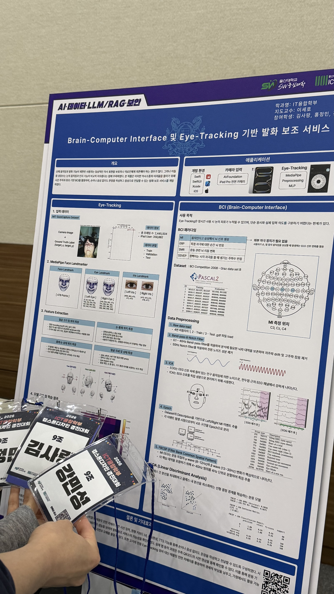
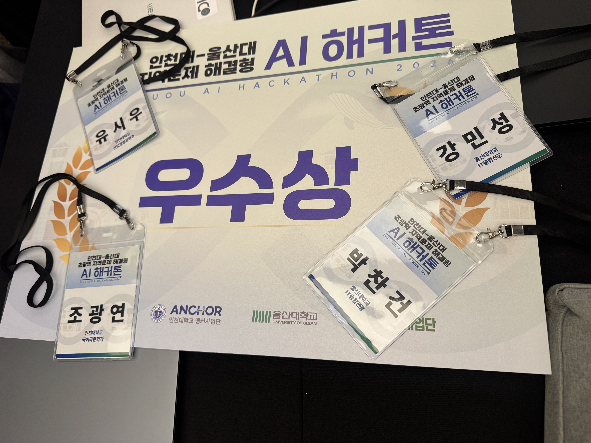

## 시선 추적 개발에서 BCI 개발로

팀 싹쓰리는 2025년 9월부터 캡스톤 디자인과 졸업작품을 함께 진행했다. 신체 움직임이나 발화에 어려움이 있는 사용자가 시선으로 문자와 단어를 선택하고, 선택한 내용을 음성으로 전달할 수 있는 서비스를 목표로 했다.

2025-2학기에는 시선 추적 모델과 프로토타입 앱을 개발했다. 원형 키보드 인터페이스를 설계하고, GazeCapture 데이터셋과 MediaPipe로 추출한 특징을 활용해 시선 좌표를 예측하는 MLP 모델을 개발했다. 당시 BCI는 다음 학기에 결합할 기능으로 방향을 정리했다. 초기 과정은 [RISE 캡스톤 디자인 어워드 참가 기록](/posts/ssak3-rise-capstone/)에 따로 적었다.

2026-1학기에는 그 계획을 이어 받아 BCI 개발과 시선 추적 기능 고도화를 진행했다. 나는 BCI 모델 개발, 학습용 데이터 구성과 Python 기반 처리 파이프라인 구축에 참여했다. 이 프로젝트로 ICT융합학부 캡스톤 디자인 어워드에 참가했다.

## BCI를 어떤 역할로 활용하려 했나

시선 추적에서는 사용자가 화면의 어느 위치를 바라보는지 예측한다. 이를 문자나 단어 선택에 활용할 수 있지만, 화면을 바라보는 것만으로 실제 입력 의도를 구분하기는 어렵다. 팀에서는 시선 추적이 입력 후보를 탐색하고, BCI가 선택을 확인하는 역할을 맡도록 구조를 설계했다.

BCI는 뇌의 신호를 분석해 컴퓨터 입력에 활용하는 뇌-컴퓨터 인터페이스다. 이번 개발에서는 EEG(뇌전도) 데이터와 운동심상(MI) 신호를 활용했다. 운동심상은 실제로 움직이지 않고 손이나 팔을 움직이는 것을 상상하는 것으로, 이때의 뇌파 패턴을 분류 대상으로 삼았다.

먼저 공개 데이터셋(Pascal2 : BCI Competition IV - 2b DataSet)의 왼손·오른손 운동심상 신호를 분류하고, 그 결과를 앱의 입력 확인에 활용하는 방향으로 개발했다. 운동심상 데이터의 분류 라벨과 앱에서 실행할 명령을 어떻게 연결할지도 함께 살펴봐야 했다.

## 내가 맡은 데이터 처리와 모델 개발

BCI 학습에는 공개 EEG 데이터셋인 BCI Competition IV 데이터를 활용했다. Python 환경에서 EEG 분석 라이브러리인 MNE를 이용해 GDF 형식의 원시 데이터를 불러오고, 데이터에 포함된 이벤트 정보를 바탕으로 학습에 필요한 구간과 라벨을 구성했다.

시선 추적에서는 얼굴 이미지에서 추출한 수치 특징과 화면 좌표를 연결했다면, BCI에서는 시간에 따라 변화하는 EEG 신호와 운동심상 라벨을 연결해야 했다. 같은 모델 개발이라도 입력 데이터의 구조와 정답이 의미하는 내용이 달랐다.

데이터 처리와 학습은 다음 흐름으로 구성했다.

1. **원시 데이터와 이벤트 확인:** EEG 신호를 불러오고 왼손·오른손 운동심상에 해당하는 이벤트와 라벨을 확인했다.
2. **전처리와 구간 분할:** 주파수 필터링과 독립성분분석(ICA)을 활용해 잡음 성분을 다루고, 이벤트를 기준으로 신호를 일정 구간인 에포크(epoch)로 나눴다.
3. **특징 추출:** 주파수 대역별 공간 특징을 추출하는 FBCSP를 활용해 분류에 사용할 특징을 구성했다.
4. **모델 학습과 평가:** 추출한 특징을 LDA(선형판별분석) 분류기에 입력해 학습하고, 예측 결과를 라벨과 비교하는 구조로 정리했다.

이 과정에서 내가 맡은 데이터셋 구성과 처리 코드가 다음 학습 단계에 어떤 형태의 데이터를 전달하는지 이해하려고 했다. EEG 신호 Data 전처리의 핵심은 잡음(Noise)를 제거하고 원하는 Target의 특징은 살리는 것이 모델 성능의 척도였다. 이에 따라 신호를 불러오는 것부터 전처리, 특징 추출, 분류까지 단계가 연결되므로 각 단계의 입력과 출력, 라벨의 의미를 파악하는 것이 중요했다. 우리팀의 공개 DataSet EDA부터 전처리 PipeLine에서는 ICA를 통한 Noise 제거와 FBCSP(FilterBankCSP) : 운동심상(MI) Hz구간별 특징 분류를 통한 학습 DataSet 구축이 핵심적으로 작용했다.

그 결과 BCI 모델의 정확도는 99.38%이 나왔으며, 이후에는 실제 사용자의 EEG Data 측정을 하여 상용화 할 수 있는 모델을 개발하려 했지만 연구실의 장비의 한계로 실제 데이터 측정이 제대로 이뤄어지지 않아 공개 DataSet으로 검증한 것에 만족을 해야 했다.

## 초기 버전과 달라진 부분

| 구분 | 2025-2학기 초기 개발 | 2026-1학기 후속 개발 |
| --- | --- | --- |
| 핵심 목표 | 시선 추적 모델과 프로토타입 앱 개발 | BCI 개발과 시선 추적 기능 고도화 |
| 주로 다룬 데이터 | 얼굴 이미지에서 추출한 특징과 시선 좌표 | EEG 신호와 운동심상 이벤트·라벨 |
| 모델의 과제 | 눈 주변 특징으로 화면상의 시선 위치 예측 | EEG에서 추출한 특징으로 운동심상 신호 분류 |
| 서비스 구성 | 원형 키보드와 시선 입력 구현, BCI 결합 방향 정리 | 기존 시선 입력에 BCI 확인 과정을 연결하는 구조 구체화 |

대회에서는 시선 입력과 BCI가 각각 어떤 역할을 맡는지, 두 기능을 어떤 흐름으로 연결하려는지를 정리했다. 시선으로 입력 후보를 탐색하고 BCI로 선택을 확인한 뒤, 완성한 문장을 음성으로 전달하는 구성이었다.

공개 EEG 데이터셋에서의 분류 결과와 실제 사용자·기기에서 동작하는 입력 확인 기능은 검증 범위가 다르다. 모델의 평가 결과와 앱 연동 결과를 구분하고, 각 단계에서 확인한 내용과 더 검증해야 할 부분을 따로 남길 필요가 있다고 생각한다.

최종적으로 Eye-Tracking과 BCI 모델 개발, LLM API 연동(Gemini)을 통한 문장 자동완성 기능 그리고 TTS로 음성 변환 기술을 적용했다.

## 결과와 배운 점

ICT융합학부 캡스톤 디자인 어워드에서 **우수상**을 받았다. 초기 시선 추적 개발에서 끝내지 않고, 다음 학기에 BCI 개발과 기능 고도화를 이어 가며 같은 프로젝트를 발전시키는 경험을 했다.

**Fit-Bool**(PE파일 악성코드 탐지 AI개발)과 시선 추적 모델 개발에서 배운 데이터 처리 경험을 이번 BCI 개발에도 연결해 볼 수 있었다. 다만 입력 데이터가 이미지 기반 특징에서 EEG 신호로 바뀐 만큼, 기존에 사용한 방법을 그대로 적용하기보다 데이터의 구조와 특징부터 다시 살펴봐야 했다(DataSet EDA의 중요성을 뼈저리게 느낌...).

시선 추적 모델을 개발할 때 입력·출력·정답의 관계를 이해하는 것이 중요하다고 느꼈다. BCI에서도 EEG 신호가 어떤 특징으로 바뀌고, 그 특징에서 얻은 분류 결과가 서비스에서 어떤 역할을 맡는지 연결해서 이해하는 것이 중요했다(시간 흐름에 따른 신호 Data이다보니 Noise 제거와 특징 분류가 제일 중요하긴 했던..?). 앞으로는 내가 직접 수행한 작업과 팀 전체가 만든 결과를 구분하고, 초기 버전에서 무엇을 바꿨는지도 더 구체적으로 기록하려고 한다.

## 참고 기록

- [2026년 1학기 대회 목록](https://app.notion.com/p/341368ff7ae68061a6dddb67388f6598)
- [2026년 1학기 캡스톤디자인 어워드 신청 내용](https://app.notion.com/p/371368ff7ae680f5a406d07c8c4d5bc5)
- [최종 결과물 정리](https://app.notion.com/p/358368ff7ae6802a8f1af31ce63efb34)

## 활동 사진

사진을 누르면 크게 볼 수 있습니다.

  <figure class="post-gallery-card">
    
    <figcaption><strong>졸업작품 발표 판넬</strong>Eye-tracking · BCI 발화보조 서비스</figcaption>
  </figure>
  <figure class="post-gallery-card">
    
    <figcaption><strong>초광역 해커톤 수상 기록</strong>캡스톤 대회와 별개로 참여한 활동</figcaption>
  </figure>

*두 번째 사진은 ICT융합학부 캡스톤 대회와 별개로 참여한 초광역 AI 지역문제 해결형 해커톤의 수상 기록이다.*
