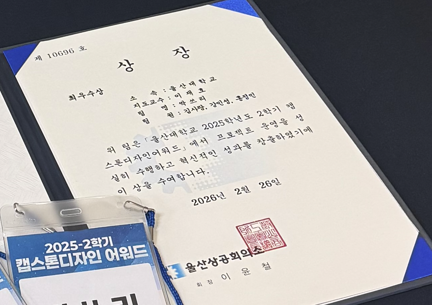
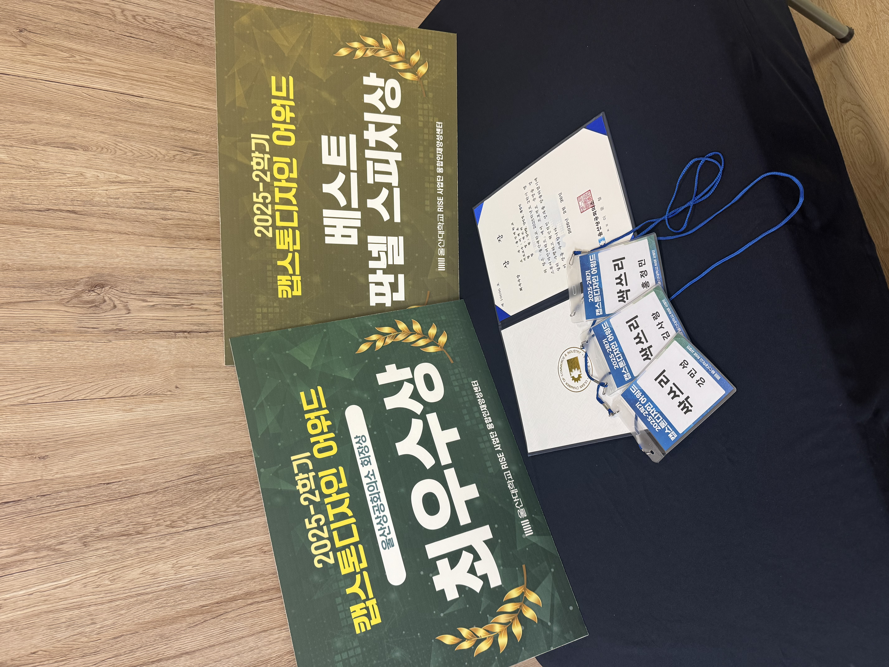
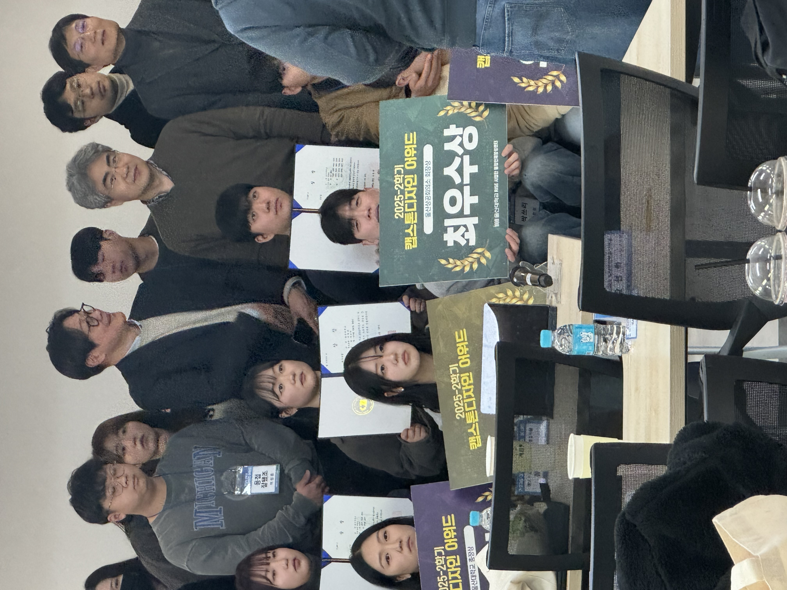
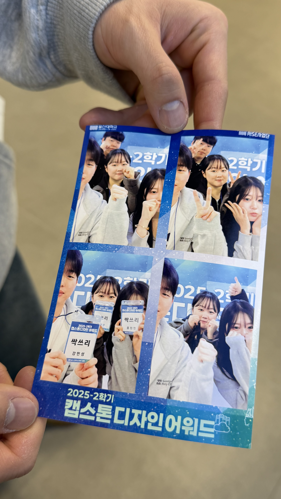

## 발화보조 서비스를 시작한 배경

팀 싹쓰리는 [25.09.01 ~ 26.06.30(캡스톤 디자인 ~ 졸업작품)]동안 함께하며 졸업작품 1등을 목표로 꾸린 팀이다.
주제는 회의를 통해 최종적으로 신체 움직임이나 발화에 어려움이 있는 사용자의 의사소통을 돕는 서비스를 개발하기로 했다.
시선으로 화면의 문자나 단어를 선택하고, 선택한 내용을 음성으로 전달하는 구성이었다. 추가로 시선 추적뿐 아니라 뇌-컴퓨터 인터페이스인 BCI를 결합하는 방향도 함께 검토했다.

이 프로젝트로 RISE 사업단 캡스톤 디자인 어워드에 참가했다. 나는 Eye-tracking·BCI 모델 개발, 학습용 데이터 구성과 프로젝트 발표에 참여했다. 이 글에서는 그중 초기 시선 추적 개발과 대회 준비 과정을 중심으로 정리한다.

## 내가 맡은 데이터 처리와 모델 개발

시선 추적에는 MIT의 공개 데이터셋인 GazeCapture를 활용했다. 얼굴(눈동자, 홍채, 고개 각도 등) 이미지와 해당 DataSet의 측정자가 바라보는 시선이 Device(= Iphone 또는 Ipad)의 화면 어디를 응시하는지에 대한 정보를 모델이 사용할 수 있는 학습용 데이터로 구성하는 작업이 필요했다.

팀에서는 OpenCV, Dlib, MediaPipe를 살펴보며 얼굴과 눈 주변 특징을 추출하는 방법을 비교했다. 나는 MediaPipe를 활용한 검토와 데이터 처리 작업에 참여했다. 이후 Python 기반 전처리와 학습용 데이터 구성(전러리 + 시선 추적을 위한 추가 데이터 생성)을 진행하며 시선 추적 모델 개발에 적용했다.

초기 제출 자료에는 MediaPipe를 이용한 눈 주변부 특징(Feature)추출을 한 정보들을 학습용 DataSet으로 묶었다. 학습에 사용한 모델은 MLP를 사용했다. IMG를 기반으로 추론하는 CNN을 사용하지 않은 이유는 우리 팀의 Target Device가 Mobile Application 이었기 때문에 단순 Feature 값들(수치 Data)만으로 학습 시켜 모델 자체의 무게를 경량화할 수 있도록 MLP를 선정하였다. 모델 학습 이후 시선 좌표 예측, 사용자별 보정과 좌표 떨림을 줄이기 위한 처리 방법(Calibration)을 추가하였다. 이 과정에서 어떤 데이터를 입력으로 쓰고 어떻게 표현하는지. 즉, Input - Output - Target들의 구조와 관계를 이해함이 중요하다는 것을 확인했다.

## 대회에서 설명한 서비스 구성

2025-2학기 우리팀의 목표는 시선추적 모델을 완성하고 프로토타입을 개발하는 것이었다.
2025-2학기동안 싹쓰리는 아래와 같은 결과를 냈다.

1. 시선추적에 최적화된 원형 키보드 인터페이스 자체 설계 & 디자인
2. Eye-Tracking 모델 개발 & 프로토타입 APP 개발
3. BCI 결합 방향(BCI는 26-1학기 목표)을 제출 자료로 정리했다.

향후 계획으로 BCI 결합 + Eye-Tracking 성능 고도화를 잡았으며, 나는 모델·데이터 작업과 함께 프로젝트 발표에도 참여했다.
목표에 맞춰 이번 대회에서는 시선 추적 모델을 적용시킨 입력 화면과 전체 서비스의 동작을 함께 설명했다.

시선 추적과 BCI를 어떻게 연결할지, 각 기능이 사용자 입력에서 어떤 역할을 맡는지도 함께 고민했다. 이후 개발에서는 이러한 설계 방향을 구체화하고 각 기능의 동작을 확인하는 과정을 이어 가려고 했다.

## 결과와 배운 점

RISE 사업단 캡스톤 디자인 어워드에서 **울산상공회의소 회장상 최우수상**과 **베스트 판넬 스피치상**을 받았다.

**Fit-Bool**(PE파일 악성코드 탐지 AI개발)에서 얻은 데이터와 모델 개발 경험을 다른 주제에 적용해 볼 수 있었고, 팀원들과 함께 프로젝트를 진행하며 이번 대회 뿐 아니라 여러 대회(다른 게시글 참고)에서도 수상을 하게 되며 자신감도 얻었다. 내가 맡은 모델과 데이터 처리가 전체 서비스에서 어떤 역할을 하는지 이해하고 설명하는 일도 중요하다고 느꼈다.

이후에도 개발을 이어갔다. 후속 활동은 [ICT융합학부 캡스톤 디자인 어워드 기록](/posts/ssak3-ict-capstone/)에서 별도로 정리한다.

## 참고 기록

- [2025년 2학기 대회 목록](https://app.notion.com/p/336368ff7ae68034bcd1db28d51c4aa8)
- [초기 캡스톤 자료 페이지](https://app.notion.com/p/2b1368ff7ae6801b96aefd10ac298c3b)
- [어워드 신청 준비](https://app.notion.com/p/2b3368ff7ae680c19f1ef81bb6a2dc5f)
- [초기 최종 제출 내용](https://app.notion.com/p/2ba368ff7ae680e4ac1fe3b9cf2c920d)
- [싹쓰리 프로젝트](https://app.notion.com/p/25d368ff7ae68016bfbec3aa9ce5995a)

## 활동 사진

<!-- 검토 메모: 정확한 개최·수상일, 원형 UI·BCI 기능의 당시 실제 구현 범위 확인. 원문 MAE 수치는 단위·평가 조건을 확인하지 못해 사용하지 않음. -->
