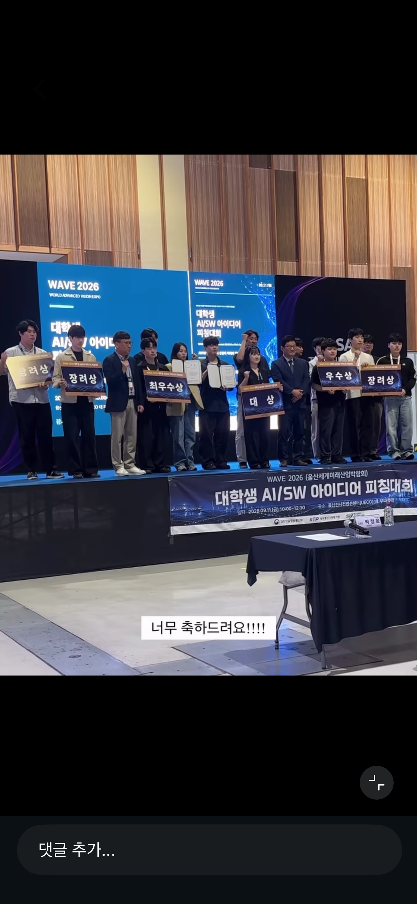
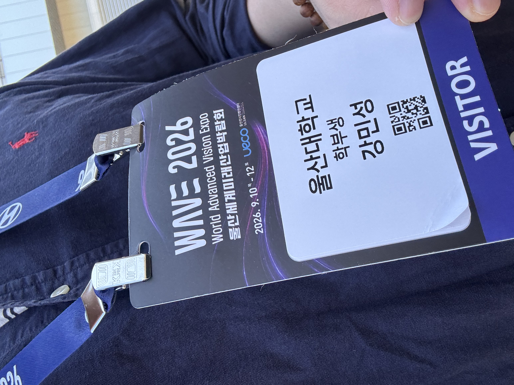
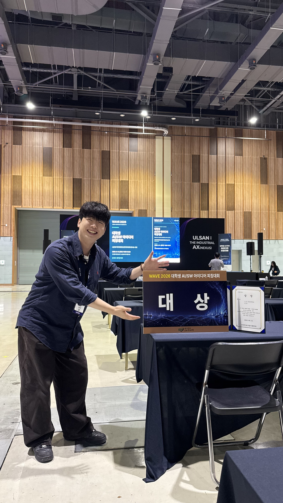
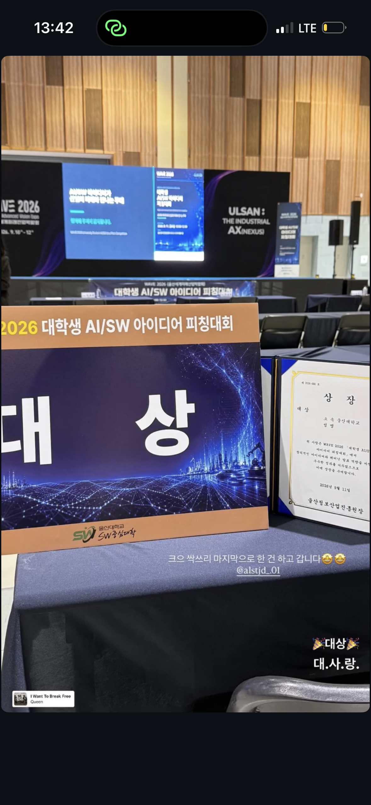

## 어떤 아이디어로 참가했나

2026 WAVE(울산세계미래산업박람회) 대학생 AI·SW 아이디어 피칭대회에 Eye-tracking과 BCI를 활용한 발화보조 기기를 주제로 참가했다. 싹쓰리 팀에서 이어 온 발화보조 서비스 개발과 연결되는 활동이었다.

아이디어의 목적은 발화나 신체 움직임에 어려움이 있는 사용자의 의사소통을 돕는 것이었다. 시선으로 원하는 문자나 단어의사를 표현하도록 지원하는 기기를 제안했다.

## 기존 개발 경험과의 연결

이 아이디어의 기반이 된 프로젝트에서 나는 Eye-tracking·BCI 모델 개발, 데이터셋 구축, Python 기반 처리 파이프라인과 기능 고도화에 참여했다.

초기 캡스톤 디자인과 후속개발을 통한 최종 결과물을 성과 측면이 아닌 미래산업이라는 분야에서 어떻게 적용될 수 있는지에 대해 집중하였다.
2026 WAVE 대회를 준비하며 2개 기술의 시장조사(산업 규모, 대표 기업, 상용화된 제품, 연구 개발중인 제품들 등등)를 했다.
이를 통해 **Eye-Tracking : 활발한 연구 & 개발**이 이어져오고 있으며,  **BCI : 떠오르는 연구 분야**의 결합으로 우리 팀의 아이디어는 미래 산업과 밀접하게 연관되어 있음을 알 수 있었다.

## 결과와 앞으로 보완할 기록

이 대회에서는 발표와 QnA를 철저히 준비한 결과 **대상**을 받았다.

그동안 최우수상, 우수상을 수상하며 1등인 대상을 받지 못해 아쉬움이 컸었다.
하지만 마지막 대회라 생각한 WAVE에서 대상을 수상하게 되며 **싹쓰리**의 여정이 결실을 맺게되었다.
수상을 하는 순간 울컥했지만, 1년이라는 기간이 지났음을 새삼 느끼며 허탈(?)한 감정도 느꼈다..
개발한 기술이 어떤 사용자를 돕고 어떤 문제를 해결하려는지 설명하는 일도 프로젝트의 중요한 부분이라고 생각한다.
개발을 잘 하는 것도 중요하지만 자신이 개발한 것이 어디에 어떤 목적으로 활용될 수 있는지 파악하는 자세도 필요함을 배웠다.

## 관련 활동과 참고 기록

- [발화보조 서비스 초기 개발·RISE 캡스톤 기록](/posts/ssak3-rise-capstone/)
- [발화보조 서비스 고도화·ICT융합학부 캡스톤 기록](/posts/ssak3-ict-capstone/)
- [싹쓰리 프로젝트](https://app.notion.com/p/25d368ff7ae68016bfbec3aa9ce5995a)
- [대회 참가·수상 기록이 있는 포트폴리오](https://app.notion.com/p/ab0fec1bbff6827fa4838101aa20be5f)

## 활동 사진

사진을 누르면 크게 볼 수 있습니다.

  <figure class="post-gallery-card">
    
    <figcaption><strong>시상식 단체사진</strong>WAVE 2026 아이디어 피칭대회</figcaption>
  </figure>
  <figure class="post-gallery-card">
    
    <figcaption><strong>행사 참가 기록</strong>WAVE 2026 참가 명찰</figcaption>
  </figure>
  <figure class="post-gallery-card">
    
    <figcaption><strong>대상 수상 기념</strong>싹쓰리 팀의 마지막 대회</figcaption>
  </figure>
  <figure class="post-gallery-card">
    
    <figcaption><strong>대상 판넬과 상장</strong>WAVE 2026 대학생 AI·SW 아이디어 피칭대회</figcaption>
  </figure>

