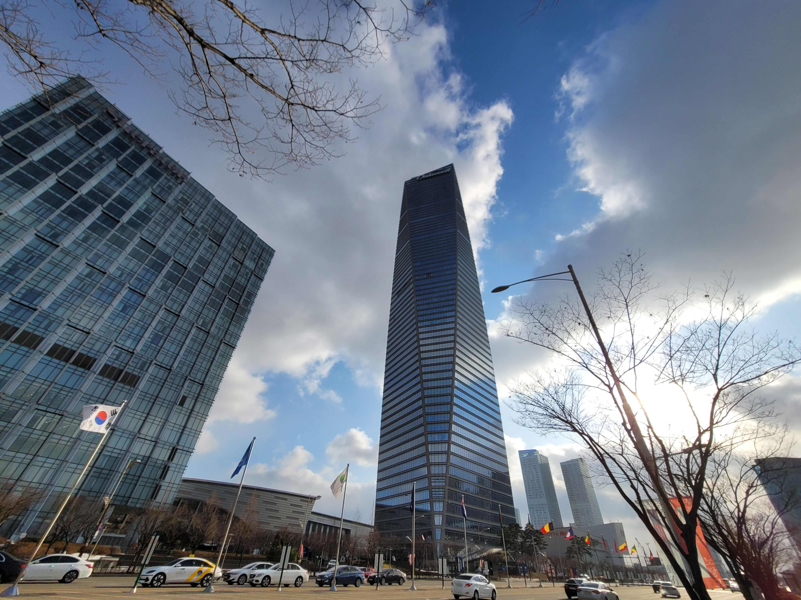
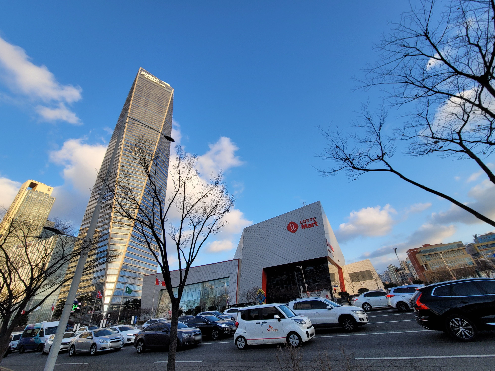
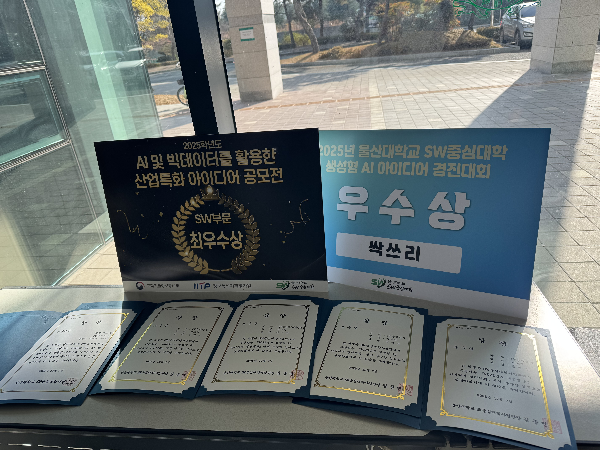

## 어떤 활동이었나

2025년 AI 및 빅데이터를 활용한 산업특화 아이디어 공모전에 싹쓰리 팀으로 참가했다. 빅데이터를 활용한 3D 증강 모델 개발에 참여했고, 본선 준비에서는 자료 정리와 PPT 제작을 함께 맡았다.

팀에서는 지역의 과거와 현재를 이미지와 3D 표현으로 보여 주는 방향을 검토했다. 특정 장소의 모습뿐 아니라, 시간이 지나면서 주변 일대가 어떻게 달라졌는지를 전달하는 아이디어였다. 이를 위해 필요한 이미지와 데이터셋, 2D 이미지를 3D로 표현하는 방법을 살펴봤다.

## 내가 맡은 일과 준비 과정

아이디어를 논의하면서 Eye-tracking 프로젝트에서 얻은 발상을 제안했고, 공업단지나 건축 공간을 VR로 살펴보는 방향도 함께 검토했다. 본선 준비에서는 팀원과 자료를 정리하고 PPT를 제작했다.

개발 자료에는 AI-Hub 데이터셋을 참고한 기록과 이미지·영상 기반 변환 결과를 정리한 페이지를 남겼다. 3D 변환 자료에서는 근거리 정면·좌측·우측 사진과 영상, 3D 파일을 확인하는 방법을 구분해 정리했다.

기술 조사에서는 여러 시점의 이미지로 구조를 복원하는 SfM과, 여러 이미지에서 장면을 학습해 새로운 시점의 모습을 표현하는 NeRF를 후보로 살펴봤다.

## 본선 준비와 결과

본선 PPT와 시연영상을 준히했다. 사용한 자료는 데이터셋 출처, 기술 구성, 기대효과와 개선방안을 정리했고, 현재와 과거의 모습을 3D Gaussian Splatting (3DGS)을 사용했다. 아이디어의 실현 가능성을 보여주기위해 프로토타입으로 개발했으며, 완성도는 높지 않았지만 목적인 실현 가능성을 보여주었다. (각 지역의 중요 건물, 지형들의 이미지만 있다면 충분히 구현 가능함을 보여줌) 최종적으로 이 공모전에서 SW중심대학사업단장상 최우수상을 받았다.

## 돌아보며

이 활동은 모델 개발과 함께 아이디어를 설명하는 자료를 만드는 경험이기도 했다. 어떤 데이터를 사용하고 무엇을 보여 주려 했는지, 아이디어와 실현의 경계를 허물 수 있도록 하는 것이 중요함을 배웠다.

## 참고 기록

- [대회 준비 페이지](https://app.notion.com/p/29c368ff7ae68079ba6ee45097d93dda)
- [기술 구현 자료](https://app.notion.com/p/2be368ff7ae680b898b9c40625d97a31)
- [3D 변환 자료](https://app.notion.com/p/2b1368ff7ae680e8a96ef6c8fb88e054)
- [본선 준비 메모](https://app.notion.com/p/2af368ff7ae68085b4d2f71464c1b674)
- [기술 조사 메모](https://app.notion.com/p/2af368ff7ae68073b956e625e425cafb)

## 시연 영상

공모전 본선 준비 과정에서 제작한 프로토타입 시연 영상이다.

<figure class="post-media">
  <video controls playsinline preload="metadata" poster="../../assets/images/posts/ssak3-industrial-ai-idea/demo-poster.jpg" aria-label="3D Gaussian Splatting 프로토타입 시연 영상">
    <source src="../../assets/videos/posts/ssak3-industrial-ai-idea/demo.mp4" type="video/mp4">
    영상을 재생할 수 없는 환경에서는 <a href="../../assets/videos/posts/ssak3-industrial-ai-idea/demo.mp4">시연 영상 파일</a>을 열어 볼 수 있다.
  </video>
  <figcaption><strong>프로토타입 시연</strong>3D Gaussian Splatting으로 구성한 장면을 살펴보는 영상</figcaption>
</figure>

## 데이터셋 대표 이미지

프로젝트에서 참고한 데이터셋의 대표 이미지다. 데이터셋 출처는 [AI-Hub의 3D 관광지 데이터(관광명소)](https://aihub.or.kr/aihubdata/data/view.do?dataSetSn=71596)다.

사진을 누르면 크게 볼 수 있습니다.

  <figure class="post-gallery-card">
    
    <figcaption><strong>데이터셋 대표 이미지 1</strong>건물과 주변 공간을 담은 장면</figcaption>
  </figure>
  <figure class="post-gallery-card">
    
    <figcaption><strong>데이터셋 대표 이미지 2</strong>다른 시점에서 바라본 건물과 주변 공간</figcaption>
  </figure>

## 수상 기록

  <figure class="post-gallery-card">
    
    <figcaption><strong>산업특화 아이디어 공모전 최우수상</strong>생성형 AI 아이디어 경진대회 우수상 판넬과 함께 남긴 수상 기록</figcaption>
  </figure>

