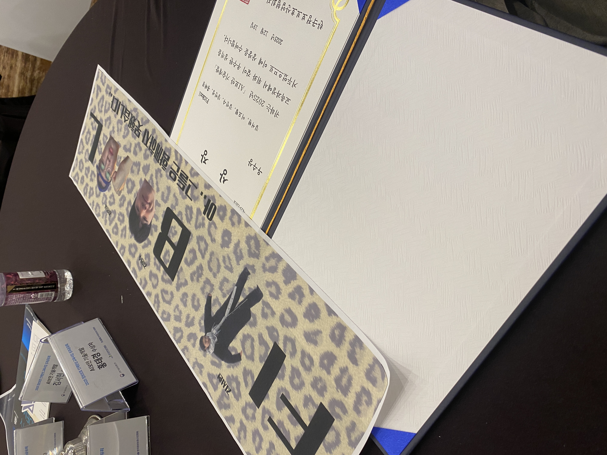

## 악성코드를 AI로 분류해 보기

2025년 6월 30일부터 10월 28일까지 KISIA AI 보안 기술개발 교육과정 악성코드반에 참여했다. 교육에서 배운 내용을 바탕으로 Fit-Bool 팀에서 악성코드 탐지 모델과 서비스를 개발했다.

팀에서는 파일의 정적 정보, 실행 중 나타나는 동적 정보, 파일을 이미지로 변환한 정보를 각각 분석했다. 나는 이 중 **PE 파일을 이미지로 변환하고 CNN으로 정상·악성을 분류하는 이미지 분석 모델**을 맡았다. PE(Portable Executable)는 Windows 실행 파일과 DLL 등에 사용되는 파일 형식이다.

## 파일을 이미지 데이터로 바꾸는 과정

이미지 모델이라고 해서 실행 화면을 촬영한 사진을 사용하는 것은 아니었다. 파일의 바이트를 밝기 값으로 바꾸고, 이를 2차원 배열로 배치해 회색조 이미지로 만들었다. 이렇게 구성한 이미지를 CNN의 입력으로 사용했다.

내가 다룬 전처리 흐름은 다음과 같았다.

1. 정상·악성 PE 파일을 모으고 파일 형식과 기본 조건을 확인
2. SHA-256 해시를 이용해 내용이 같은 파일을 확인하고 중복을 정리
3. 파일의 바이트를 회색조 이미지로 변환하고 300×300 크기로 Resizing
4. 정상·악성 라벨을 연결하고 학습·검증·평가에 사용할 데이터 분할
5. 모델 입력에서는 회색조 이미지를 세 채널로 읽어 CNN에 전달 및 학습

정상 데이터는 팀원들과 수집한 PE 파일을 정리했고, 악성 데이터에는 KT-Malware를 사용했다. 같은 파일이 학습 데이터와 평가 데이터에 함께 들어가면 이미 본 파일을 다시 맞히는 평가가 될 수 있어, 중복과 분할을 함께 살펴봤다.

## 모델보다 먼저 다시 확인해야 했던 데이터

처음부터 최종 데이터셋과 모델이 정해져 있었던 것은 아니다. 1차 모델을 만든 뒤 정상 데이터의 출처가 분명하지 않은 문제가 있어 해당 구성을 취소하고 데이터를 다시 정리했다.

모델을 학습시켜 결과를 얻었더라도, 어떤 데이터로 만든 결과인지 설명할 수 있어야 했다. 파일을 모으는 일과 학습에 사용할 수 있는 데이터셋을 만드는 일이 다르다는 것을 이 과정에서 느꼈다. 데이터 출처와 중복 여부를 확인하는 작업도 모델 개발의 일부였다.

## CNN 모델 비교와 최종 학습

이미지 분류에는 EfficientNet-B0와 EfficientNetV2-S 등을 후보로 두고 비교했다. 정상·악성 파일을 각각 2,000개씩 사용한 PoC 비교를 거쳐 최종적으로 **EfficientNetV2-S**를 선택했다. PoC는 본격적인 개발 전에 작은 범위에서 가능성과 결과를 확인하는 과정이다.

아래는 당시 내가 최종 학습 기록에 남긴 수치다.

| 지표 | 기록한 값 |
| --- | --- |
| 정확도 | 94.92% |
| PR-AUC | 0.9968 |

이 수치는 당시 구성한 데이터와 평가 조건에서 얻은 결과다. 새로운 악성코드나 다른 출처의 정상 파일에서도 같은 성능이 나온다는 뜻은 아니다. 이미지 모델이 학습한 패턴과 실제 악성 행위의 관계도 구분해서 봐야 한다.

## 팀 전체 서비스와 연결하기

이미지 모델은 팀 전체 탐지 서비스의 한 부분이었다. 팀에서는 정적·동적·이미지 분석 모델이 내놓은 예측 확률을 soft voting으로 결합했다. 여러 모델의 확률을 함께 사용해 최종 결과를 정하는 방식이었다.

## 결과와 배운 점

교육과정을 수료했고, Fit-Bool 프로젝트로 **한국정보보호산업협회장상 우수상과 단체 부문 1등**을 받았다. 상장에 기재된 수상일은 2025년 12월 19일이다.

이 활동을 통해 모델 개발뿐 아니라 팀 프로젝트에서 내가 맡은 부분을 끝까지 정리하는 경험을 했다. 데이터셋을 구성하고 전처리한 뒤 모델에 전달하는 과정이 중요했고, 결과가 나왔을 때도 어떤 데이터와 조건에서 나온 것인지 설명할 수 있어야 했다.

이후 시선 추적과 BCI 모델을 개발할 때도 이 경험을 연결해 볼 수 있었다. 입력 데이터의 형태는 달라졌지만, 입력과 정답의 의미를 파악하고 전처리부터 평가까지 연결해서 보는 과정은 계속 필요했다.

## 참고 기록

- [Fit-Bool 프로젝트](https://app.notion.com/p/23122f1948db809f959ae9609b1d211a)
- [내 이미지 모델 개발 과정](https://app.notion.com/p/2aefec1bbff6811789a4e3c429d4f6c4)
- [전처리와 최종 모델 정리](https://app.notion.com/p/2aefec1bbff6818dbe0fd95be5835d4f)

## 수료와 수상 기록

사진을 누르면 크게 볼 수 있습니다.

  <figure class="post-gallery-card">
    
    <figcaption><strong>시상식 날의 상장과 응원 현수막</strong>Fit-Bool 팀의 수상을 함께 기념한 날</figcaption>
  </figure>
  <figure class="post-gallery-card">
    
    <figcaption><strong>수료증과 우수상 상장</strong>AI 보안 기술개발 교육과정 악성코드반 수료 기록</figcaption>
  </figure>

