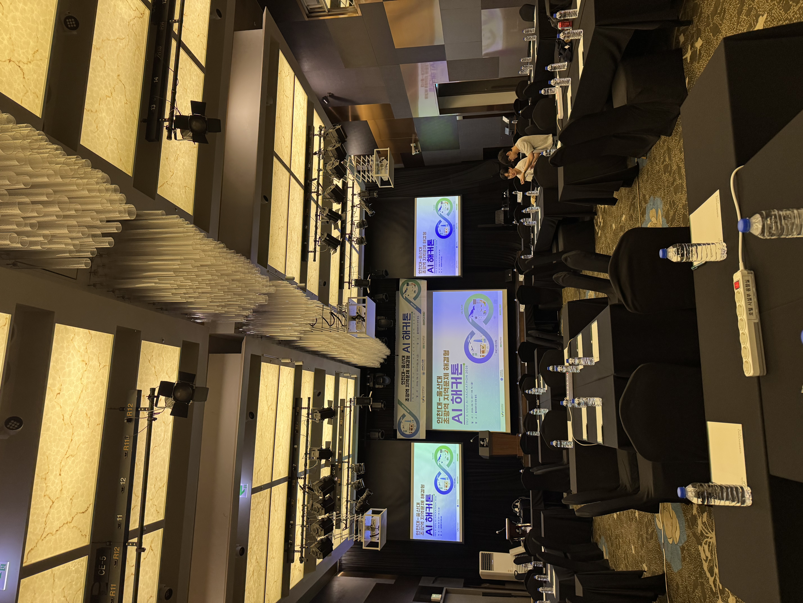
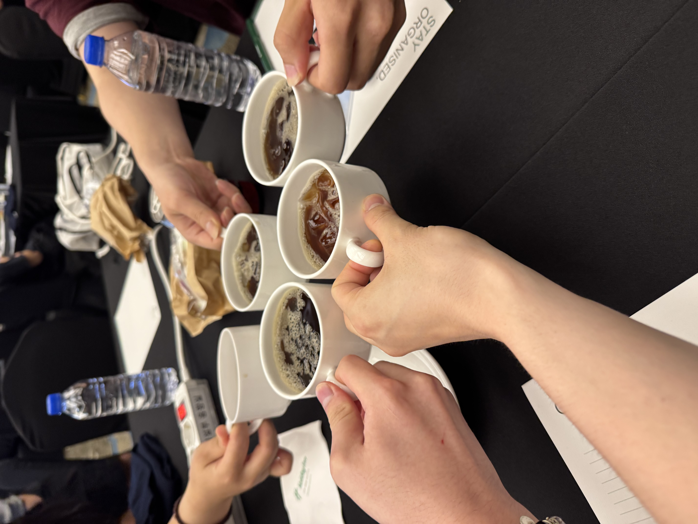
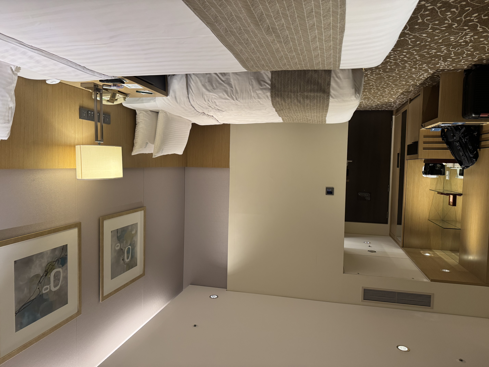
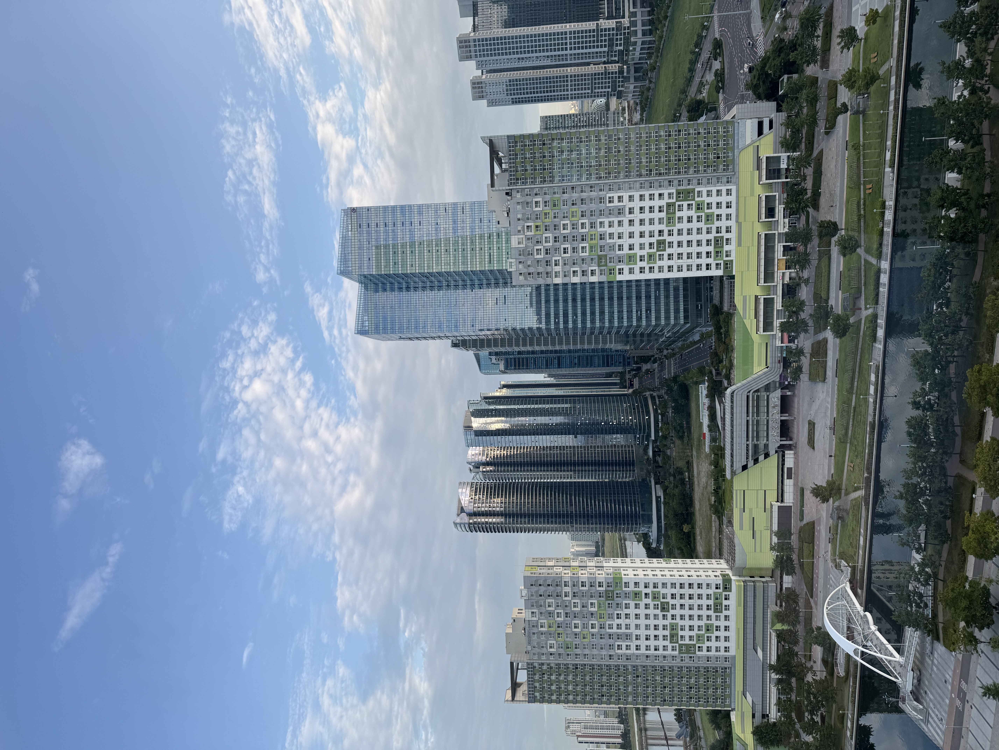
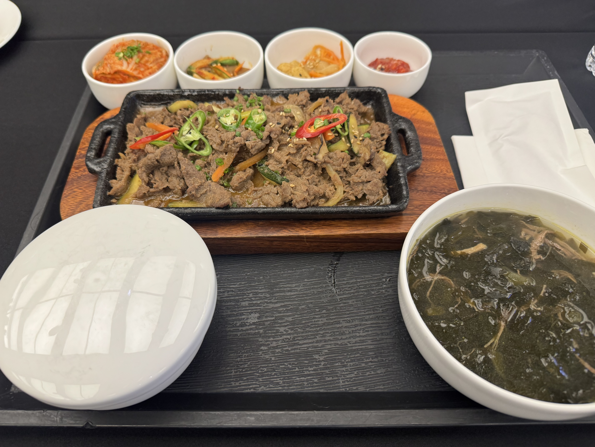
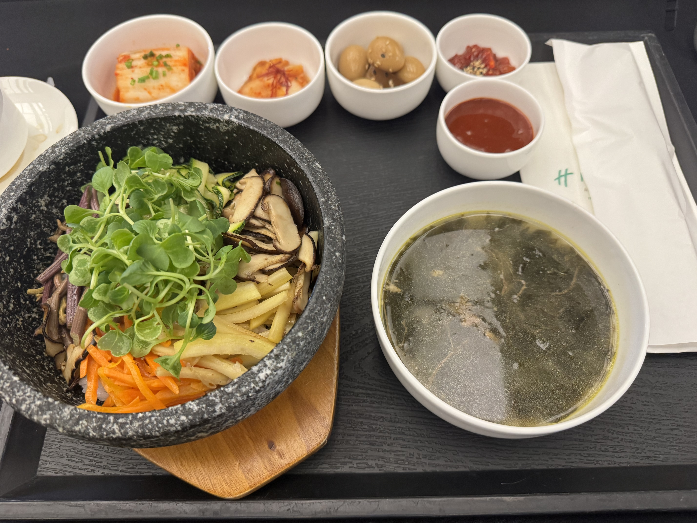
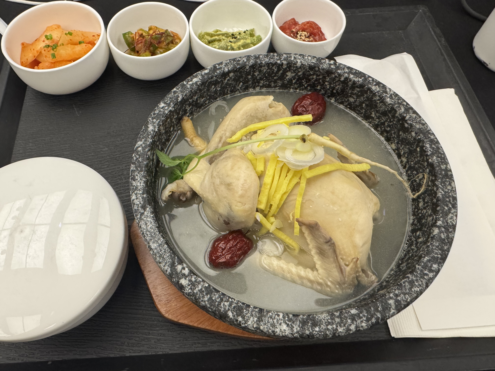
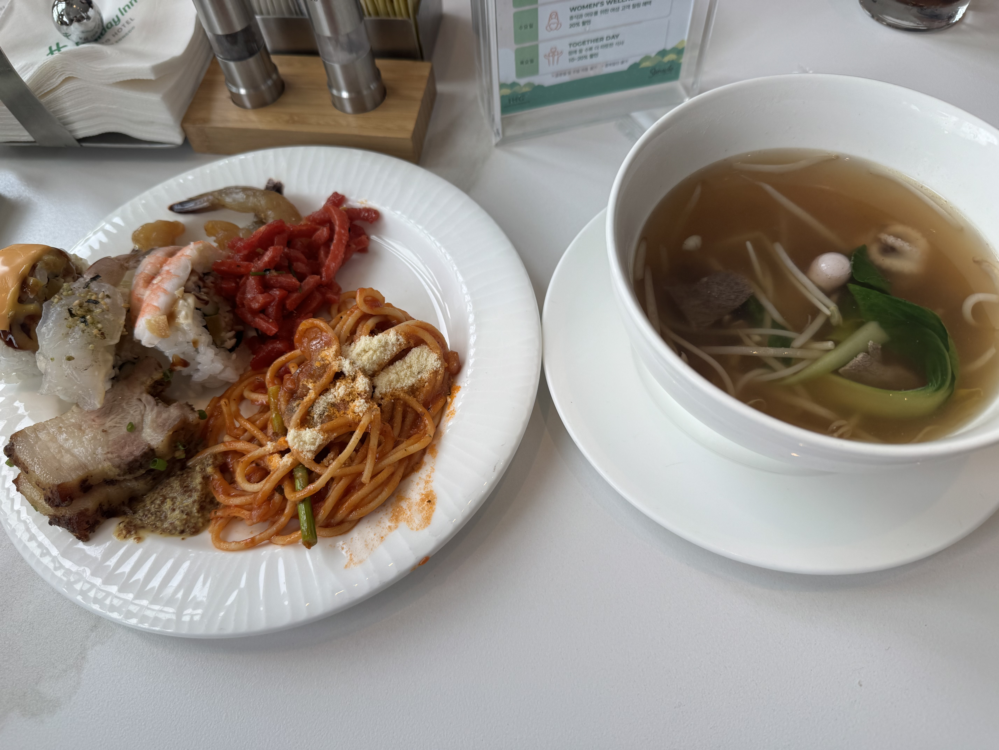

## 타 대학 학생들과 함께한 2박 3일

2026년 8월 12일부터 14일까지 울산대학교와 인천대학교가 함께한 초광역 AI 지역문제 해결형 해커톤에 참가했다. 타 대학 학생들과 팀을 구성해 2박 3일 동안 하나의 결과물을 준비했다.

우리 팀이 다룬 주제는 **산업구조 전환: 탄소중립·AX·에너지**였다. 결과물의 이름은 Carbon AX Navigator로 정했다. 나는 팀장을 맡았고, 최종 발표는 조광연이 담당했다.

## 중소기업은 어디서부터 시작해야 할까

탄소중립과 AI 도입이라는 주제를 그대로 다루면 범위가 너무 넓었다. 팀에서는 중소기업이 어떤 데이터를 먼저 모으고, 어떤 설비부터 확인하거나 개선해야 할지를 돕는 방향으로 문제를 좁혔다.

울산의 주요 산업 중에서는 석유화학 중소기업을 대상으로 서비스 구상을 정리했다. 설비와 에너지 사용 정보를 바탕으로 현재 상태를 살펴보고, 탄소 감축과 AX 전환의 다음 단계를 안내하는 서비스였다. 여기서 AX는 AI를 업무와 의사결정에 적용하는 전환을 뜻한다.

## Carbon AX Navigator의 구성

서비스에서는 기업의 전력 사용량과 생산량, 설비 사양과 가동시간 등을 입력받는 흐름을 준비했다. 입력한 정보를 이용해 다음 내용을 보여 주는 구성이었다.

- 전력 사용에 따른 탄소배출량과 에너지 사용 수준
- 우선 확인하거나 개선할 설비
- 개선안에 따른 예상 절감액과 투자비 회수기간
- 기업의 준비 수준에 맞춘 단계별 AX 전환 방향

전력 사용에 따른 간접 배출량은 Scope 2로 구분했다. 이처럼 계산할 항목을 정리한 뒤, 결과를 단순한 숫자로 끝내지 않고 다음 행동과 연결하려고 했다.

## 시연한 범위와 앞으로 필요한 검증

준비 과정에서 정리한 프로토타입은 **규칙 기반 계산과 시연용 데이터**를 중심으로 구성했다. 정해진 계산식과 기준값으로 진단 결과를 만들고, 그 결과를 설명하는 챗봇 화면을 함께 준비하는 방식이었다.

챗봇에는 실제 LLM을 호출하지 않는 Mock 구성도 포함돼 있었다. 따라서 모든 결과를 AI 모델이 예측했다거나, 실제 기업에 적용해 탄소배출을 줄였다고 설명할 수는 없다. 실제 LLM 연동과 현장 데이터 검증은 시연용 기능과 구분해서 남겨야 할 부분이다.

예상 절감액과 투자비 회수기간 역시 입력값과 시연용 가정에 따라 달라지는 계산 결과였다. 현장 효과를 확인하려면 실제 기업의 데이터를 모으고, 추정한 값과 측정한 값을 비교하는 과정이 더 필요했다.

## 내가 맡은 역할과 협업

팀장으로 참여하면서 팀원들과 문제 정의와 서비스 방향을 정리했다. 개발 역할도 나눠 맡았고, 조광연은 최종 발표를 담당했다. 각자의 작업이 하나의 서비스 설명으로 이어지도록 개발 내용과 발표 준비를 함께 맞춰 가는 과정이었다.

첫날에는 과제 분석과 역할 분담, 아이디어 구체화를 진행했다. 둘째 날에는 프로토타입과 시연 영상, 발표 자료를 준비했고, 마지막 날에는 제출과 발표에 맞춰 결과물을 정리했다. 짧은 기간 안에 무엇을 보여 줄지 결정해야 하는 활동이었다.

## 결과와 돌아본 점

Carbon AX Navigator로 **우수상**을 받았다.

익숙한 팀과 진행하던 캡스톤 프로젝트와 달리, 다른 대학과 전공의 학생들과 짧은 시간 안에 함께 결과물을 만드는 경험이었다. 각자가 맡은 작업을 진행하는 것과 함께, 우리가 해결하려는 문제가 무엇인지 같은 방향으로 설명하는 일도 중요했다.

처음에는 전공 동기들과 호캉스(?)를 겸해 가볍게 경험해 보자는 마음으로 참가했다. 하지만 막상 대회장에 가니 열정이 불타올랐고, 2박 3일 동안 해커톤에 몰두했다. 좋은 호텔에 묵었지만 숙소에서는 세 시간 정도 자고 샤워만 한 게 아쉬웠다.

숙소와 식사도 기억에 남는다. 호텔 식사에 다양한 간식과 무제한 커피까지 제공됐다. 대회가 끝난 뒤에는 호텔 뷔페에도 갔지만, 버스 시간 때문에 30분 만에 서둘러 먹어야 했다. 여유롭게 즐기지 못한 아쉬움도 있었지만, 그만큼 열정을 쏟았던 대회였다.

## 참고 기록

- [Carbon AX Navigator 해커톤 자료](https://app.notion.com/p/3b9fec1bbff680518504c25eea2c388d)
- [1일차: 문제 정의와 역할 분담](https://app.notion.com/p/3b9fec1bbff6800a8661f2265d42f85f)
- [2일차: 프로토타입과 분석 흐름](https://app.notion.com/p/3b9fec1bbff680228547e9ae6548955b)
- [3일차: 발표 준비와 Q&A](https://app.notion.com/p/3b9fec1bbff680edae42d117beeaa794)

## 활동 사진

사진을 누르면 크게 볼 수 있습니다.

### 대회의 시작

  <figure class="post-gallery-card">
    
    <figcaption><strong>초광역 AI 해커톤 대회장</strong>2박 3일 동안 아이디어를 구체화한 공간</figcaption>
  </figure>
  <figure class="post-gallery-card">
    
    <figcaption><strong>시작 전, 동기들과 커피 한 잔</strong>해커톤 시작을 앞두고 함께한 건배</figcaption>
  </figure>

### 숙소와 창밖 풍경

  <figure class="post-gallery-card">
    
    <figcaption><strong>잠깐 머물렀던 숙소</strong>짧은 잠과 샤워만으로 기억에 남은 호텔 객실</figcaption>
  </figure>
  <figure class="post-gallery-card">
    
    <figcaption><strong>숙소에서 바라본 송도 풍경</strong>창밖으로 보이던 건물과 수변 풍경</figcaption>
  </figure>

### 식사와 해커톤의 마무리

  <figure class="post-gallery-card">
    
    <figcaption><strong>해커톤 식사 - 불고기</strong>개발 중간에 챙겨 먹었던 한 끼</figcaption>
  </figure>
  <figure class="post-gallery-card">
    
    <figcaption><strong>해커톤 식사 - 돌솥비빔밥</strong>기억에 남은 호텔 식사</figcaption>
  </figure>
  <figure class="post-gallery-card">
    
    <figcaption><strong>해커톤 식사 - 삼계탕</strong>2박 3일의 일정 사이에 먹은 식사</figcaption>
  </figure>
  <figure class="post-gallery-card">
    
    <figcaption><strong>해커톤을 마친 뒤, 뷔페</strong>버스 시간에 맞춰 서둘러 먹었던 마지막 식사</figcaption>
  </figure>

